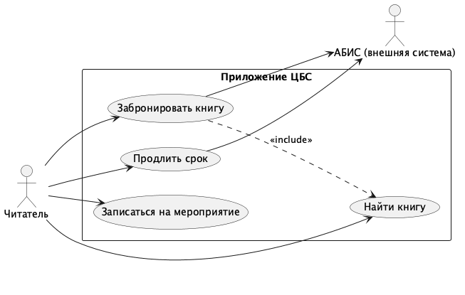
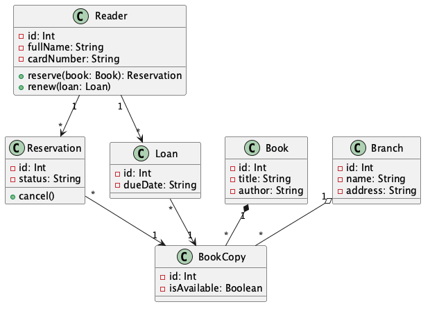
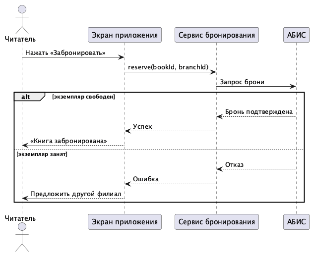
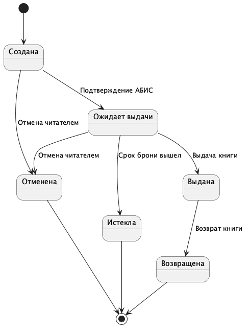
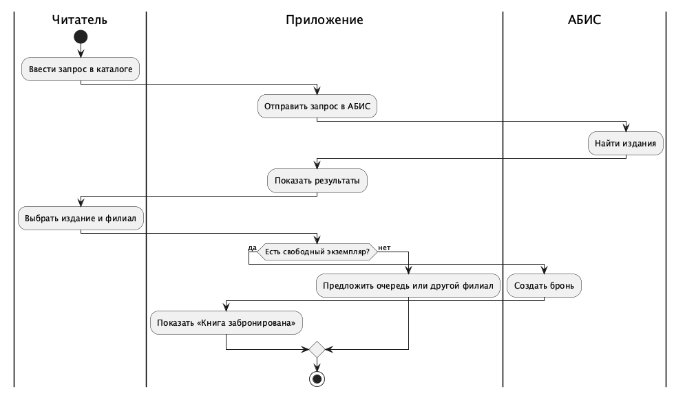

# Диаграммы UML для ВКР

Тема: Разработка iOS-приложения для Центральной библиотечной системы Петроградского района

## Предметная область

Центральная библиотечная система (ЦБС) Петроградского района объединяет несколько филиалов, в которых читатели берут книги, продлевают сроки и ходят на мероприятия. Разрабатываемое iOS-приложение позволяет читателю искать книги в электронном каталоге, бронировать экземпляр в удобном филиале, следить за сроками возврата и продлять их, а также записываться на мероприятия библиотеки.

Основные пользователи: читатели библиотеки и сотрудники (библиотекари), которые обрабатывают брони и ведут списки участников мероприятий. Данные о книгах, выдачах и бронях хранятся в автоматизированной библиотечной информационной системе (АБИС), с которой приложение обменивается данными.

## Структура репозитория

```
vkr-uml/
├── README.md
├── diagrams/      исходники диаграмм (.puml, PlantUML)
├── images/        готовые картинки диаграмм (PNG)
├── code/          код, сгенерированный из диаграммы классов (Swift)
└── tools/         скрипт генерации кода
```

## Подход к выполнению

1. Описал предметную область и выделил основные сценарии: поиск и бронирование книги, продление срока, запись на мероприятие.
2. Составил диаграммы в PlantUML (в VS Code с расширением PlantUML). Использовал статические диаграммы (use case, классы) и динамические (последовательности, состояния, деятельности).
3. Экспортировал диаграммы в PNG командой `plantuml -tpng -o ../images diagrams/*.puml`.
4. Из диаграммы классов сгенерировал каркас кода на Swift скриптом `tools/generate_swift.py`.

## Диаграммы

### Use case




Комментарий: на диаграмме показано, что может делать пользователь в приложении. Основной актор — читатель, он ищет книги, бронирует их, продлевает сроки и записывается на мероприятия. Внешняя система АБИС выступает вторичным актором: к ней приложение обращается, когда нужно создать бронь или продлить срок. Вариант использования «Забронировать книгу» включает в себя «Найти книгу» (связь include), потому что бронь невозможна без выбора издания. Диаграмма соответствует трём use case, которые описаны в тексте для ВКР.

### Классы




Комментарий: диаграмма показывает основные сущности предметной области. У издания (Book) может быть много физических экземпляров (BookCopy), которые находятся в филиалах (Branch). Читатель (Reader) связан с бронями (Reservation) и выдачами (Loan), а те ссылаются на конкретный экземпляр книги. Связь Book и BookCopy показана композицией, потому что экземпляр не существует без издания, а Branch и BookCopy связаны агрегацией. У классов указаны атрибуты и основные методы, например, `reserve()` у читателя и `cancel()` у брони.

Код: папка [code/](code/). Он сгенерирован из `class.puml` скриптом `tools/generate_swift.py`:

```
python3 tools/generate_swift.py diagrams/class.puml code
```

Скрипт создаёт для каждого класса файл `.swift` с полями, инициализатором и методами-заглушками. Связи между классами в код не переносятся и дописываются вручную.

### Последовательность




Комментарий: диаграмма показывает порядок обмена сообщениями при бронировании книги. Читатель нажимает «Забронировать» на экране приложения, экран передаёт запрос сервису бронирования, а тот обращается к АБИС. Блок `alt` описывает два варианта: если экземпляр свободен, бронь подтверждается и читатель видит сообщение об успехе, а если занят — приходит отказ, и приложение предлагает выбрать другой филиал. Так видно, как распределены обязанности между интерфейсом, сервисом и внешней системой.

### Состояния



Исходник: [diagrams/state.puml](diagrams/state.puml)

Комментарий: диаграмма описывает жизненный цикл брони. Бронь создаётся в состоянии «Создана», после подтверждения АБИС переходит в «Ожидает выдачи». Дальше возможны три исхода: книгу выдали («Выдана»), читатель отменил бронь («Отменена») или истёк срок хранения («Истекла»). Выданная книга после возврата переводит бронь в состояние «Возвращена». Отменённая, истёкшая и возвращённая брони — конечные состояния.

### Деятельность




Комментарий: диаграмма описывает процесс поиска и бронирования книги от начала до конца. Действия распределены по трём дорожкам: читатель, приложение и АБИС. Читатель вводит запрос и выбирает издание с филиалом, приложение отправляет запросы в АБИС и показывает результаты. После выбора идёт ветвление: если свободный экземпляр есть, АБИС создаёт бронь и читатель получает подтверждение, если нет — приложение предлагает встать в очередь или выбрать другой филиал.

## Макеты интерфейса

Макеты экранов приложения: https://size-bit-31792490.figma.site
